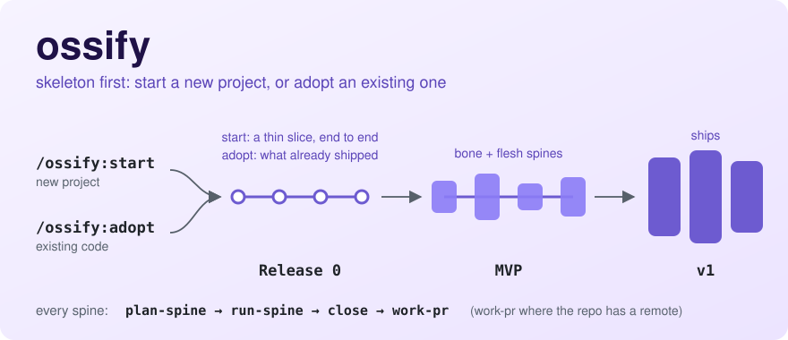
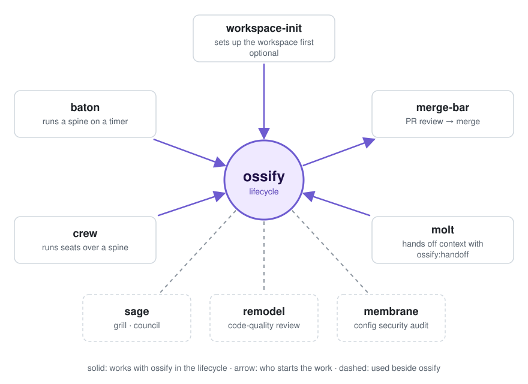
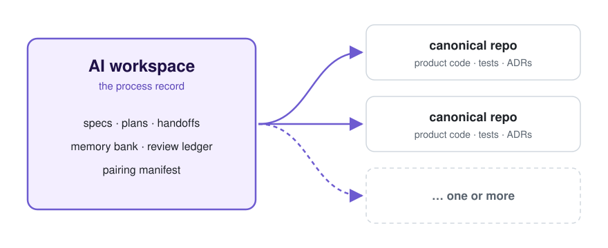

<p>
  
</p>

# pulsestack

<p><b>Workflow plugins for coding agents — from the first spec to a merged, tagged release.</b></p>

<p>
  
  
  
  <a href="./LICENSE"></a>
</p>

The plugins we run every day to ship real software with coding agents (Claude Code, Codex and
OMP), from one marketplace.

Instead of jumping straight to code, **ossify** starts from a skeleton: a thin slice that runs end
to end on a new project, or the code that already shipped on an existing one. Then it grows that
skeleton spine by spine. Each work item is built test-first, checked by an agent that did not build
it, and reviewed before it merges. Most of the other plugins plug into that loop; the rest work
beside it.

**[Install](#install)** · [How ossify works](#how-ossify-works) · [All plugins](#all-plugins)

<picture>
  <source media="(prefers-color-scheme: dark)" srcset="docs/assets/readme/ossify-skeleton-dark.svg">
  
</picture>

## How ossify works

<table>
<tr>
<td width="50%" valign="top">
<code>/ossify:start</code> · <code>/ossify:adopt</code><br>
<b>Begin a project</b>
<ul>
<li>Map the user journey.</li>
<li>Cut the skeleton: the thinnest slice that runs end to end.</li>
<li>Record the risk gates: hazards whose harm a failed test cannot undo.</li>
<li><code>adopt</code> takes existing code, with or without the legacy scaffold stack, and closes what already shipped as Release 0.</li>
</ul>
</td>
<td width="50%" valign="top">
<code>/ossify:plan-release</code><br>
<b>Plan a release</b>
<ul>
<li>Groom the feature map.</li>
<li>Set the exit criteria.</li>
<li>Order the spines as a graph.</li>
<li>A fail-closed critic reviews the plan: a veto-grade finding makes its spine a bone spine, or comes to you.</li>
</ul>
</td>
</tr>
<tr>
<td width="50%" valign="top">
<code>/ossify:plan-spine</code> → <code>/ossify:run-spine</code><br>
<b>Plan and run a spine</b>
<ul>
<li>One to five work items, planned in rounds, with a cumulative demo that must keep running.</li>
<li>A bone spine is offered a grilling, one question at a time, before it is built.</li>
<li>One worktree per work item, built test-first.</li>
<li>A verifier that did not build the item judges it at close.</li>
</ul>
</td>
<td width="50%" valign="top">
<code>/ossify:work-pr</code> · merge-bar<br>
<b>Review and merge</b>
<ul>
<li>The PR body fixes its merge bar when the PR opens.</li>
<li>Reviewers report findings against that bar.</li>
<li>Blocking findings are fixed in one push per round.</li>
<li>Merge; a release is a tag on the merged line.</li>
</ul>
</td>
</tr>
</table>

`/ossify:work-pr` runs merge-bar's PR loop where merge-bar is installed, and ossify's own loop
otherwise. The full command set is in [ossify's README](./ossify/README.md).

## How the plugins fit together

<picture>
  <source media="(prefers-color-scheme: dark)" srcset="docs/assets/readme/plugin-hub-dark.svg">
  
</picture>

A solid arrow marks a plugin that works with ossify inside the lifecycle, and it points away from
the side that starts the work. A dashed line marks a plugin you use beside ossify: ossify does not
call it and works without it.

## One AI workspace, clean product repos

<picture>
  <source media="(prefers-color-scheme: dark)" srcset="docs/assets/readme/dual-repo-dark.svg">
  
</picture>

Agent process stays out of your product history. Specs, plans, handoffs and the review record live
in one AI workspace; code, tests and ADRs land in the canonical repos it manages, one or
more. `/workspace-init:init-workspace` sets the pair up and writes the pairing manifest.
workspace-init's job ends there: its continuation for new workspaces is `ossify`.
workspace-init is optional for ossify:
`/ossify:start` and `/ossify:adopt` can write `.ossify/topology.json` themselves.

## Install

Built for Linux and macOS; CI runs on Linux.

<details open>
<summary><b>Claude Code</b></summary>

```
/plugin marketplace add github:pulseai-labs/pulsestack
/plugin install ossify@pulsestack
/plugin install merge-bar@pulsestack
/plugin install sage@pulsestack
/plugin install remodel@pulsestack
/plugin install membrane@pulsestack
/plugin install crew@pulsestack
/plugin install seat-mods@pulsestack
/plugin install molt@pulsestack
/plugin install baton@pulsestack
```

`workspace-init` is **optional** for ossify: `/ossify:start` and `/ossify:adopt`
author `.ossify/topology.json` themselves. Install it when you also want the
dual-repo bootstrap and the AI-trace commit-msg filter; ossify reads its
`pairing.json` as a fallback.

```
/plugin install workspace-init@pulsestack
```

</details>

<details>
<summary><b>Codex</b></summary>

Codex support is dual-published from the same repo through
`.agents/plugins/marketplace.json`. The Codex marketplace exposes:

- `workspace-init`
- `sage`
- `membrane`
- `remodel`
- `crew`
- `merge-bar`
- `ossify` (rounds are driven from Claude Code, which registers the
  implementer subagent — Codex does not)

```
codex plugin marketplace add github:pulseai-labs/pulsestack
```

</details>

<details>
<summary><b>OMP</b></summary>

OMP reads `.omp-plugin/marketplace.json`, which lists the plugins whose procedures do not depend on
the harness (`ossify`, `merge-bar`, `workspace-init`, `remodel`, `sage`), the
mods (`seat-mods`, `molt`), the shared `crew` and the OMP-only `omp-roles`.

    omp plugin marketplace add pulseai-labs/pulsestack

    omp plugin install ossify@pulsestack   # and each plugin you want

OMP does not put a plugin's `bin/` on `PATH`. Install the extension that does, once per machine, in your
user extension folder; OMP loads it in every session:

    curl -fsSL --create-dirs https://raw.githubusercontent.com/pulseai-labs/pulsestack/main/omp/extensions/plugin-bin-path.ts \
      -o ~/.omp/agent/extensions/plugin-bin-path.ts

If you set `PI_CODING_AGENT_DIR`, the folder is `$PI_CODING_AGENT_DIR/extensions/` instead; change the `-o` path to match.

The file is a small loader: the logic ships inside the plugins, so `omp plugin upgrade` keeps it current,
and the loader warns with this command if it ever needs a new download. Without it, `oss`, `wi`, `mb` and `crew-run`
are not found and the skills that need them say so. A session started
with `--no-extensions` needs `-e <that file>`.

Guarded seats: install `omp-roles` and both mods, then launch with `omp-seat` (the extensions load only
through it). Link its `bin/omp-seat` onto `PATH` as `omp-roles/README.md` shows. It needs `bun`, and `seat-mods` and `molt` at the minimum versions `omp-roles/README.md` names; with an older or missing install it refuses and names the version it needs.

    omp plugin install omp-roles@pulsestack   # and seat-mods, molt
    omp-seat worker --via omp -p "..."

`omp-roles` is pinned and tested on omp 18.16.0 (`omp-roles/README.md`).

</details>

<details>
<summary><b>Local development</b></summary>

Claude Code, from a local checkout:

```
/plugin marketplace add /path/to/pulsestack
/plugin install ossify@pulsestack
/plugin install workspace-init@pulsestack
/plugin install sage@pulsestack
/plugin install membrane@pulsestack
/plugin install remodel@pulsestack
/plugin install crew@pulsestack
/plugin install merge-bar@pulsestack
```

Codex, from a local checkout:

```
codex plugin marketplace add /path/to/pulsestack
```

</details>

<details>
<summary><b>Renamed from claude-agent-scaffolding: move a machine</b></summary>

This marketplace had the name in the line above until November 2026. Three plugins were renamed
with it: `code-judo` is now `remodel`, `ai-mentor` is now `sage`, and `claude-security-audit` is now
`membrane`. Every other plugin keeps its name. Behaviour is unchanged; only install keys and command
namespaces (`/remodel:…`, `/sage:…`, `/membrane:…`) moved. The old GitHub URL redirects here.

To move a machine, for each harness you use:

1. **Claude Code.** First note each enabled plugin and its scope: `enabledPlugins` in
   `~/.claude/settings.json` (user), and in each project's `.claude/settings.json` (project) and
   `.claude/settings.local.json` (local). Then copy the data, before anything is removed, because
   uninstalling a plugin deletes its data directory. That directory,
   `~/.claude/plugins/data/<plugin>-<marketplace>/`, carries the marketplace name: copy each old one into
   its `-pulsestack` twin (for a renamed plugin, under the new plugin name). Then run `/plugin marketplace remove claude-agent-scaffolding`,
   then `/plugin marketplace add pulseai-labs/pulsestack`, and install the same plugins as
   `<plugin>@pulsestack` in the scope you noted (`claude plugin install <plugin>@pulsestack --scope project`
   or `--scope local`; user is the default), with the three new names in place of the old.
2. **Codex.** Run `codex plugin marketplace remove claude-agent-scaffolding-codex`, then
   `codex plugin marketplace add pulseai-labs/pulsestack`, and enable the same plugins. Hook-trust
   entries in `~/.codex/config.toml` are keyed by `plugin@marketplace`, so re-trust them under
   `pulsestack-codex`.
3. **OMP.** Run `omp plugin marketplace remove claude-agent-scaffolding`, then add `pulseai-labs/pulsestack`
   and install the same plugins, then download the bin-path loader again (the `curl` line under
   the OMP block above). Relink anything on `PATH` that pointed into the old plugin cache (for example `omp-seat`).

For one release, the OMP bin-path module and loader also read installs under the old marketplace
name (`marketplace remove` not run yet), so a machine keeps working until it moves.

</details>

## All plugins

| Plugin | What it does |
|---|---|
| [`ossify`](./ossify/) | Skeleton-first delivery lifecycle, from the first spec to a tagged release; starts new projects and adopts existing ones. |
| [`merge-bar`](./merge-bar/) | Pull requests against a merge bar fixed when the PR opens: open, review, fix, merge. |
| [`workspace-init`](./workspace-init/) | Bootstrap or pair the dual-repo workspace (AI workspace + canonical) and install the AI-trace commit-msg filter. |
| [`sage`](./sage/) | Decision support: grill me, a council of perspectives, plain re-explanation, beginner's mind. |
| [`remodel`](./remodel/) | Strict code-quality review and architecture deepening. |
| [`membrane`](./membrane/) | Static security audit of project configs and enabled plugins. Not in the OMP catalog. |
| [`crew`](./crew/) | The orchestrator/worker session model over herdr or Orca: one session keeps its context for decisions, worker seats do the work. |
| [`baton`](./baton/) | A recipe-driven engine that launches sessions in Orca terminals on a timer; ships a recipe that runs an ossify spine. Claude Code catalog only. |
| [`molt`](./molt/) | Context handoff as a mod: warns as the context window fills, then hands off and resumes. Claude Code and OMP. |
| [`seat-mods`](./seat-mods/) | Role guards for worker seats, as a mod. Claude Code and OMP. |
| [`omp-roles`](./omp-roles/) | The OMP role pack: the `omp-seat` launcher and its seat roles. OMP only. |

## License

MIT — see [`LICENSE`](./LICENSE).
