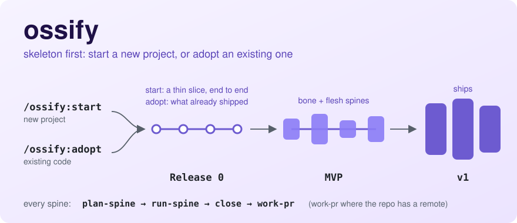

# ossify

<picture>
  <source media="(prefers-color-scheme: dark)" srcset="../docs/assets/readme/ossify-skeleton-dark.svg">
  
</picture>

ossify is a skeleton-first delivery lifecycle for coding agents. Release 0 is a thin slice of the
product that runs end to end. Each later release is a promise phrased as what a user can do at
close, delivered by spines that each cross the whole product. Every spine adds lines to a
cumulative demo that runs again at every later close, so the product works at every step, not only
at the end.

The skills hold the judgment: what the journey map says, where the skeleton cut falls, whether a
critic finding is a veto. A small dispatcher, `oss`, does the bookkeeping: state, IDs, registries,
worktrees and the mechanical gates.

**[Quick start](#quick-start)** · [Commands](#commands) · [Concepts](#concepts) ·
[Harnesses](#harnesses) · [Configuration](#configuration) · [Changelog](./CHANGELOG.md)

## Quick start

Install ossify from the pulsestack marketplace. The [root README](../README.md#install) has the
steps for Claude Code, Codex and OMP. On Claude Code:

```
/plugin marketplace add github:pulseai-labs/pulsestack
/plugin install ossify@pulsestack
```

Then start from the case that fits:

- **A new project:** run `/ossify:start`. It walks the decisions that come before code and hands
  off to `/ossify:plan-release` for Release 0.
- **A project that already has code:** run `/ossify:adopt`. It closes what already shipped as
  Release 0, and Release 1 is planned next.

After that, plan each release once, then run every spine in it through the same three steps, and
close the release last:

```
/ossify:plan-release           # once per release
/ossify:plan-spine <spine-id>  # then, for each spine:
/ossify:run-spine <spine-id>
/ossify:close <spine-id>
/ossify:close <release-id>     # after the last spine
```

A spine's close lands its work by PR through `/ossify:work-pr` where the repo has a remote, and a
release is a tag on the merged line.

## Commands

Each command is also a skill. On Codex and in OMP you reach it by its skill name (see
[Harnesses](#harnesses)).

### The lifecycle

| When you want to | Command | What it does |
|---|---|---|
| Onboard a new project | `/ossify:start` | Walks the pre-code decisions: the journey map, the skeleton cut, the bones, the risk gates and the privacy posture. Writes a lean MASTER-SPEC, the memory bank, the bone ADRs and a seed feature map, then hands off to `/ossify:plan-release` for Release 0. It refuses a repo that already has product source and routes it to `/ossify:adopt`. |
| Bring in a codebase that already shipped | `/ossify:adopt` | Takes a repo with product source, with or without the legacy scaffold stack. Runs fail-closed gates and six conversions, then closes what already shipped as Release 0. A repo with no legacy stack must have a step that works from a clean checkout today; adoption refuses or halts without one. |
| Plan a release | `/ossify:plan-release` | Grooms the feature map, phrases the exit criteria, picks the spines and orders them as a DAG, declares each spine's class (bone, flesh, or the rare internal enabler) under the critic's veto, and writes `RELEASE.md`. Release 0 is planned here too. |
| Plan one spine | `/ossify:plan-spine <spine-id>` | Splits the spine into 1–5 work items, orders them into rounds by their dependencies, writes each work item's spec a round at a time, authors the spine's demo lines and records its fakes. A bone spine's plan is offered a grilling. |
| Build a spine | `/ossify:run-spine <spine-id>` | Cuts the spine branch, makes one worktree per work item, dispatches an implementer per item, and holds each round at a barrier. Run it again on a started spine to resume it: it prints a reconcile read-out first and halts before it changes anything it cannot reconcile. |
| Build one work item | `/ossify:work-item <handoff-path>` | The implementer's procedure: pre-flight gates, a RED gate per acceptance criterion, the TDD loop, verification and a report. It stages its work and never commits. `run-spine` dispatches it; you rarely call it yourself. |
| Close a work item, a spine or a release | `/ossify:close <id>` | Takes its scope from the id's shape: `r1.s2.w3` is a work item, `r1.s2` a spine, `r1` a release. A work item gets the impl-check gate and a verifier that did not build it. A spine gets the cumulative demo, the critic, a retro and the harvest. A release gets the full `user:` walkthrough. |

### Alongside the lifecycle

| When you want to | Command | What it does |
|---|---|---|
| Check a project's health | `/ossify:doctor [state\|spec\|rules\|interop\|budget\|provenance]` | Diagnoses state health, spec validation, rule authoring, Claude Code and Codex interop, the skill budgets and plugin provenance. With no argument it runs the full sweep. |
| Fix a defect in shipped behaviour | `/ossify:patch <issues or a described defect>` | Ships the fix, or a small request from another project that it cannot fake, as a versioned patch off the default branch: reproduce first or acceptance criteria first, then a PR and a tag. It refuses, and names the route for, new scope or a request the requester can fake (the intake queue), a request larger than one work item (a spine), and a change nothing observes (close's direct-commit lane). |
| Stress-test a plan, or audit a spec | `/ossify:challenge [artifact-path]` | With a file, it audits it adversarially. With a plan in the conversation, it grills you one question per turn. At close depth an external adversary joins when one is configured. The ceremonies call the same skill for their grill gates and their critic. |

### Without ossify set up

These need no ossify setup. `handoff` and `handoff-resume` work in any
repository; `work-pr` needs a repository that `gh` can reach, and `wayfinder` a GitHub issue
tracker.

| When you want to | Command | What it does |
|---|---|---|
| Hand the work to the next session | `/ossify:handoff [topic]` | Writes a session handoff: it judges where the file lives from repo evidence, writes the six-section core and states the read-out first. It never refuses. |
| Pick up from a handoff | `/ossify:handoff-resume [path]` | Checks the handoff's claims against the live repo, reports drift, then follows its next steps. With no path it takes the most recent handoff. It never refuses. |
| Get a PR merged | `/ossify:work-pr <PR number or URL> [--repo-root DIR]` | Drives the PR to merge with merge-bar's `working-a-pr` when merge-bar is installed, and with ossify's bundled review-fix-merge loop otherwise. Every finding gets a disposition. It merges only on the operator's explicit ack, or under a standing order that binds this role and grants merge authority. Under `working-a-pr` that covers a two-way door only; a one-way door goes to the merge holder. |
| Work through a question too big for one session | `/ossify:wayfinder [map] [ticket]` | Charts the question into decision tickets on the issue tracker, or works an existing map's frontier one ticket per session. It is for a decision, not a build slice. |

## Concepts

- **Release 0, the skeleton.** A thin slice of the product that runs end to end, with at least one
  automated golden-journey demo line. Later releases grow it to an MVP and then v1. Nothing is
  planned in detail beyond the next release.
- **Spine.** A slice of one release that crosses the whole product and delivers something a user
  can do. A rare **internal enabler** spine has no user journey: it is admitted only when it names
  the committed user-facing spine that consumes it, in this release or the next, and it adds `auto:` demo
  lines only. A spine is split into 1–5 **work items**, which run in **rounds** ordered by their
  dependencies. Each item gets its own worktree. An implementer builds it, and at close a verifier
  checks it, in a context that did not build it where the harness can dispatch one.
- **Bone and flesh.** A **bone** spine creates or changes a bone: the skeleton itself, a boundary, a
  cross-cutting contract, data ownership or a stack decision. It gets the full ceremony: grill gates
  offered at planning, a full close-depth audit, a full retro and an ADR for each bone its plan declares. A **flesh** spine lands entirely on
  existing bones and gets the core close rows plus a light critic pass. A spine whose plan touches a
  registered bone's surface is a bone spine, whatever it was declared.
- **Bones registry.** Each bone is an ADR with a touch surface: the file globs it covers.
  `oss touch_check` reports which bones and risk gates a set of paths touches.
- **Risk gates.** A hazard whose harm a test failure cannot undo: money, destructive operations,
  identity and trust, or ordering-critical correctness. Each gate has a touch surface and the
  controls its family requires. A spine that touches a gate's surface becomes a bone spine and
  takes on those controls as required work.
- **Cumulative demo ledger.** Every spine adds at least one demo line. An `auto:` line is a command
  with an expected result, run again at every later spine close. A `user:` line is a journey, a verb
  and an observable outcome, that a person walks at its own spine's close and again, with every
  other line, at each release close. A spine's own line that cannot be walked yet is deferred to a
  named release. A user-facing spine must
  add at least one `user:` line.
- **Fakes ledger.** A work item that adds or keeps a shell or a fake records it, with a reason, a
  replacement trigger and an expiry release. Fakes reduce breadth, not truth.
- **Privacy posture.** `/ossify:start` and `/ossify:adopt` decide what may become public. With no clear signal of
  intent, the posture is fully private.
- **Close.** One ceremony with three scopes. Its core rows run for every spine, bone or flesh; the
  class changes only the depth of the optional rows.

## Harnesses

ossify ships on Claude Code, Codex and OMP. The planning, diagnosis and close skills work on all
three. What differs is who builds a work item and who verifies it.

- **Claude Code.** Commands are `/ossify:<name>`. `run-spine` dispatches the
  `ossify:implementer-agent` subagent for each work item, and work-item close dispatches
  `ossify:verifier-agent`.
- **Codex.** Codex has no worker path: it registers no ossify subagent. Its planning, diagnosis and
  close skills work. Reach each skill by its name, such as `start` or `close`. `run-spine` with no
  flag refuses on Codex before it cuts the spine branch, and names `--external-executor`: drive the
  rounds from Claude Code, or with an external executor (below). A Codex close runs the verifier's checks itself and prints
  `verifier: inline`.
- **OMP.** Skill names are bare, with no `ossify:` prefix, and each skill is reachable as
  `skill://<name>`. OMP does not put a plugin's `bin/` on `PATH`, so install the loader extension in
  the root README's OMP section; without it `oss` is not found. With
  [omp-roles](../omp-roles/), `run-spine` dispatches each item to its `implementer` agent (omp-roles
  0.2.0 or later), and work-item close dispatches its `verifier` agent (0.10.0 or later). Without those agents, `run-spine` with no
  flag refuses as it does on Codex, and close runs the verifier's checks itself.

**An external executor.** `/ossify:run-spine <spine-id> --external-executor` hands the round's work
items to a procedure the caller supplies, as one `external_execution_request` per item still to
build, and takes back one `external_execution_result` each. An item that is complete, abandoned or
in flight gets no request. It names no tool, product or model. With `--detach`
after it, the lane writes the round's requests and ends; the caller counts each execution and
closes the items. The contract is
[`skills/work-item/references/external-executor.md`](./skills/work-item/references/external-executor.md).

## Configuration

- **Topology.** ossify needs one declaration: `.ossify/topology.json` in the AI workspace, which
  names the product repos. `/ossify:start` and `/ossify:adopt` write it themselves. When a
  workspace-init `.workspace/pairing.json` exists, ossify reads it as a fallback. workspace-init is
  optional. Project state lives in the AI workspace, in `.ossify/project-state.json` by default.
- **Verifier model.** On Claude Code, set `OSSIFY_VERIFIER_MODEL` in a `settings.json` env block to
  run the verifier on another model. Unset, it uses the session's model, and the close says so. On
  OMP the model is `task.agentModelOverrides.verifier` in omp's config, else the session's.
- **External adversary.** `OSSIFY_ADVERSARY` is `codex`, `claude`, `devin` or `none`. Unset, close-depth
  audits run on the host alone. `OSSIFY_ADVERSARY_TIMEOUT_S` (default 300) bounds each call, and
  `OSSIFY_ADVERSARY_MODEL` picks the model for `devin` only. The `devin` recipe keeps its read-only
  tools approved, so do not select it for an artifact you did not write or review. The recipes are in
  [`skills/challenge/references/adversaries.md`](./skills/challenge/references/adversaries.md).
- **Standing orders.** A merge, and the demo walk at a close, take a standing order from
  the project's own files: the `## Standing orders` section of `08-governance.md` first, then
  `AGENTS.md`, as the base branch has them, so an order that a PR's own diff adds binds nothing in
  that PR. An order binds only the role it names. With no order, the operator acks each merge and
  walks the demo. Under a walk order, a release close still asks the operator for one nod over the
  walk read-out.
- **merge-bar.** Optional. When it is installed, `/ossify:work-pr` follows its `working-a-pr` loop
  and a spine's close composes merge-bar's PR body fields for each repo it lands.

`/ossify:doctor provenance` reports which `oss` binary answers, which doctor body is loaded, and
which version was expected. It does not scan unused skills or decide reruns. Its guarantee begins
after one plugin update and a fresh session. On
Codex, finding the installed reference is still partial
([#399](https://github.com/pulseai-labs/pulsestack/issues/399)).

## Development

- Dispatcher: `bin/oss`. Tests: `bash tests/run-all.sh`.
- `tests/eval/` holds session-driven LLM-judge evals. `tests/run-all.sh` does not run them; walk
  them by hand with [`tests/eval/RUNBOOK.md`](./tests/eval/RUNBOOK.md).
- The design of record and the roadmap are in this repository's issues and git history, not in
  shipped files.

## Changelog

Release notes, newest first, are in [`CHANGELOG.md`](./CHANGELOG.md).

## License

MIT — see [`LICENSE`](../LICENSE).
